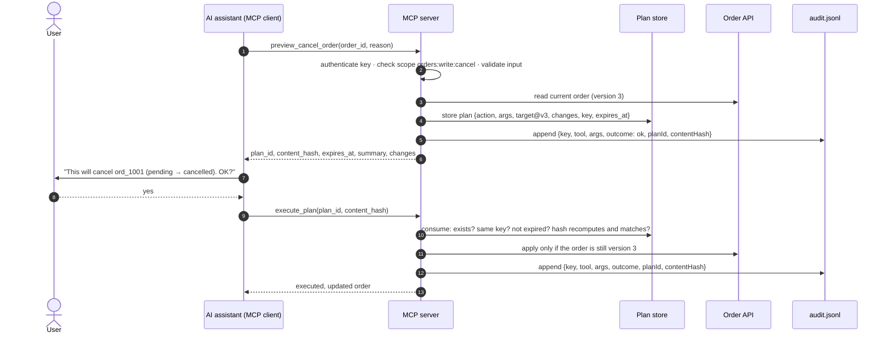

# mcp-safe-write-template

An MCP server template that gives AI assistants **write access you can actually allow**:

- **Preview → confirm → execute.** Every write is two calls. The preview returns the exact diff, a
  `plan_id`, a `content_hash` and an expiry. Nothing changes until `execute_plan` is called with that id
  *and* hash — once, by the same key, before expiry, and only if the record has not changed since.
- **Least-privilege keys.** Each API key has an explicit list of scopes. Calls outside them are refused.
  No wildcards, so adding a tool never silently widens an existing key.
- **Audit log.** One JSONL line per call — who (key id), when, which tool, which arguments, outcome —
  including denied and invalid calls. Secrets are never written.
- **Tests that are checked to bite.** Every safety rule has a test, and a mutation script breaks each rule on
  purpose to prove the tests fail.

The example backend is a **fictional order-management API** (in memory). Replace `src/domain/` and
`src/tools.ts` with your own system; the plan, scope and audit machinery stays the same.

> Status: template / reference implementation. Single process, stdio transport. Read
> [Limits](#limits) before pointing it at anything real.

## How a write flows



What `execute_plan` refuses (each row has a test, and a mutation that proves the test fails when the rule is removed):

| Situation | Error code |
|---|---|
| Plan id unknown | `plan_not_found` |
| Same plan executed twice, or after a failed attempt | `plan_already_used` |
| Called at/after `expires_at` (default 5 min) | `plan_expired` |
| Called by a key other than the one that previewed | `plan_key_mismatch` |
| `content_hash` differs from what was previewed (or the stored plan was altered) | `hash_mismatch` (plan is burned) |
| Order changed between preview and execute | `stale_plan` |
| Key lacks the scope of the planned action | `forbidden` |

The hash covers action, target and version, arguments, the displayed changes, the key id and the expiry,
in canonical (key-sorted) JSON. `execute_plan` recomputes it from the stored plan instead of trusting the
stored value.

## Tools

| Tool | Kind | Scope |
|---|---|---|
| `list_orders` | read | `orders:read` |
| `get_order` | read | `orders:read` |
| `preview_update_order_status` | preview (no write) | `orders:write:status` |
| `preview_cancel_order` | preview (no write) | `orders:write:cancel` |
| `preview_add_order_note` | preview (no write) | `orders:write:note` |
| `execute_plan` | write | scope of the planned action |

Tool annotations mark previews as read-only and `execute_plan` as destructive, so clients that ask before
destructive calls ask at the right step.

## Quick start

Requires Node.js 20+.

```bash
npm install
```

```bash
npm run build
```

```bash
npm test
```

```bash
npm run demo
```

`npm install` also points git at `.githooks/`. `npm run demo` starts the built server, drives it with a
real MCP client and prints the whole flow plus the audit log; the output is committed as
[`docs/demo.md`](docs/demo.md).

### Keys

`config/keys.example.json` contains three **demo** keys whose secrets are public:

| key id | secret (demo only) | scopes |
|---|---|---|
| `demo-reader` | `demo-reader-key-NOT-A-SECRET` | `orders:read` |
| `demo-support` | `demo-support-key-NOT-A-SECRET` | `orders:read`, `orders:write:note` |
| `demo-operator` | `demo-operator-key-NOT-A-SECRET` | all four |

For anything else, create real keys. The server stores only the sha256 of each secret:

```bash
npm run keygen -- --id support-bot --scopes orders:read,orders:write:note
```

Paste the printed entry into `config/keys.json` (git-ignored) and give the printed secret to the client.

### Configuration (environment variables)

| Variable | Default | Meaning |
|---|---|---|
| `MCP_API_KEY` | — (required) | Secret of the key this server process runs as. The server refuses to start without a valid one. |
| `MCP_KEYS_FILE` | `config/keys.json` | Key definitions (id, sha256, scopes). |
| `MCP_AUDIT_FILE` | `audit/audit.jsonl` | Audit log path (file mode 0600). |
| `MCP_PLAN_TTL_SECONDS` | `300` | How long a preview stays executable (10–3600). |

## Connect it to a client

Build first (`npm run build`) and use absolute paths.

### Claude Desktop

`claude_desktop_config.json`:

```json
{
  "mcpServers": {
    "orders": {
      "command": "node",
      "args": ["/absolute/path/to/mcp-safe-write-template/dist/index.js"],
      "env": {
        "MCP_KEYS_FILE": "/absolute/path/to/mcp-safe-write-template/config/keys.example.json",
        "MCP_API_KEY": "demo-operator-key-NOT-A-SECRET",
        "MCP_AUDIT_FILE": "/absolute/path/to/mcp-safe-write-template/audit/audit.jsonl"
      }
    }
  }
}
```

### Claude Code

```bash
claude mcp add orders \
  -e MCP_KEYS_FILE=/absolute/path/to/mcp-safe-write-template/config/keys.example.json \
  -e MCP_API_KEY=demo-reader-key-NOT-A-SECRET \
  -e MCP_AUDIT_FILE=/absolute/path/to/mcp-safe-write-template/audit/audit.jsonl \
  -- node /absolute/path/to/mcp-safe-write-template/dist/index.js
```

Or check in a project-scoped `.mcp.json` with the same `command` / `args` / `env` shape as the Desktop
example. Keep real secrets out of it: reference them as `${MCP_API_KEY}` and set them in your shell.

### MCP Inspector (CLI)

```bash
npx @modelcontextprotocol/inspector --cli -e MCP_KEYS_FILE=config/keys.example.json -e MCP_API_KEY=demo-reader-key-NOT-A-SECRET node dist/index.js --method tools/call --tool-name list_orders --tool-arg status=paid
```

## Project layout

```
src/
  index.ts            stdio entry: load config and keys, authenticate, start
  server.ts           MCP wiring (low-level Server, so even invalid calls reach the audit log)
  app.ts              transport-independent core: auth → scope → validate → run → audit
  tools.ts            tool definitions and write executors      ← replace for your system
  domain/orders.ts    fictional order API (in memory)           ← replace for your system
  plans.ts            plan store: create / consume, expiry, content hash, single use
  auth.ts             keys file, constant-time key lookup, scopes
  audit.ts            JSONL sink and redaction
tests/                vitest: two-step write, expiry, hash, scopes, audit, MCP end to end, scanner
scripts/
  demo.ts             MCP client demo → docs/demo.md
  mutation-check.mjs  breaks each safety rule on purpose; the tests must fail
  secret-scan.mjs     deterministic secret and deny-term scanner (git hooks and CI)
  keygen.ts           create a key entry
.githooks/            base-layer gate (no Claude Code needed)
.github/workflows/    CI
.claude/              Claude Code layer: harness-engine overlay (see below)
```

## Maintenance harness

The repository is maintained with two layers of checks.

**1. Base layer — any editor, no Claude Code required.**

- `.githooks/pre-commit`: secret scan of staged lines, lint, typecheck, tests.
- `.githooks/commit-msg`: English message, subject ≤ 72 characters.
- `.githooks/pre-push`: full-tree secret scan, lint, typecheck, tests.
- CI (`.github/workflows/ci.yml`): the same checks on Node 20 and 22, a smoke run of the demo against the
  built server, the mutation check, the repo scanner, and gitleaks over the full history.
- `scripts/secret-scan.mjs` uses the pattern table of harness-engine's deterministic scanner, plus
  **deny terms**: names that must never appear in the repo (an employer, a client). The list itself is
  never committed. It comes from the `DENY_TERMS` environment variable (a CI repository secret) or a
  git-ignored `.deny-terms` file.

**2. Claude Code layer — [harness-engine](https://github.com/SimSimEEE/harness-engine).**

harness-engine is a commit/PR quality gate for Claude Code. A deterministic classifier picks check lanes,
agents run them, and a `PreToolUse` hook refuses to let Claude commit or open a PR until a passing record
exists for exactly the content being committed.

harness-engine normally installs user-wide into `~/.claude`. This repo instead acts as a harness-engine
**overlay at project scope**:

- `.claude/harness/ENGINE_PIN` pins the engine version and commit.
- **The layer is opt-in.** `npm run harness:setup` turns it on: `.claude/harness/setup.sh` fetches that
  commit and lays it out under `.claude/` in git-ignored folders (it never touches `~/.claude`).
  `npm run harness:off` removes it again. Nothing runs setup automatically, because every gated commit
  starts several review agents and that cost should be a choice.
- `.claude/settings.json` registers the engine's hooks through `.claude/harness/hook.sh`, which does nothing
  while the layer is off, and steps aside when the engine is already registered user-wide.
- `.claude/harness/categories/ts-mcp-server/` tells the engine how to test this repo (vitest, secret scan,
  mutation check), and `.claude/harness/agents/test-runner.md` swaps the engine's jest steps for vitest.
- `.claude/harness/profiles/` pins this repo to that category (created with the engine's `profile.sh`).

Details and the reason for each adaptation: [`.claude/harness/README.md`](.claude/harness/README.md).

## Limits

- **Single process, in-memory plans.** A restart drops pending plans (the safe direction: preview again).
  With several replicas, move `PlanStore` to a shared store with an atomic consume.
- **stdio only, one key per server process.** `app.callTool` already takes the secret per call, so an HTTP
  transport with per-request keys is a wiring change, but it is neither included nor tested here.
- **Confirmation is the client's job.** The server guarantees that what executes is exactly what was
  previewed; it cannot prove a human said yes. Use clients that show tool calls and ask before destructive
  ones, and give keys with write scopes only to such clients.
- **Redaction is by field name** (`password`, `token`, `apiKey`, …). A secret passed in an innocently named
  field would be logged. The strict input schemas reject unknown fields, which narrows this.
- The example domain is fictional and the store is in memory.

## Credits

- [harness-engine](https://github.com/SimSimEEE/harness-engine) (Apache-2.0): the Claude Code layer, and the
  secret pattern table ported into `scripts/secret-scan.mjs`. See [`NOTICE`](NOTICE).
- [Model Context Protocol TypeScript SDK](https://github.com/modelcontextprotocol/typescript-sdk).

한국어 문서: [`docs/ko/README.md`](docs/ko/README.md)

## License

[Apache License 2.0](LICENSE)
