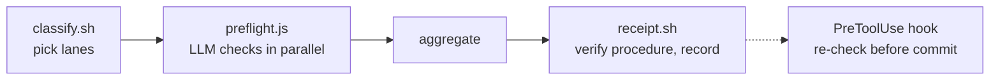

# Case study: putting an AI commit gate on another repo

When an AI agent says “all tests pass,” what should you trust? [harness-engine](https://github.com/SimSimEEE/harness-engine) is a commit gate for Claude Code that checks **what actually ran** instead of taking the agent’s word for it. This post records the first time I applied it to a repo other than its own: this repository, an MCP server template that gives AI assistants safe write access.

## The engine: the LLM sits in one box only



Code decides what to check and whether it passed. The recording step does not trust the agents’ reports: it **looks for the commands in the execution transcripts.**

## How it was adapted to this repo

The engine normally installs user-wide into `~/.claude`. A template has to work on its own for whoever clones it, so I turned the repo itself into an engine **overlay**.

| Engine default | What I did instead |
|---|---|
| Installs into `~/.claude` | Fetch the commit pinned in `ENGINE_PIN` and lay it out in git-ignored folders under `.claude/` |
| Hooks live in `$HOME/.claude/hooks` | A `hook.sh` wrapper: does nothing while the engine is absent, steps aside if it is registered user-wide |
| The test-runner agent assumes jest | Override it with a vitest version, with a warning when the original changes |
| Default category `generic` | A `ts-mcp-server` category that names vitest, the secret scan and the mutation check as required regression commands |

Underneath sits a base layer that runs without Claude Code: git hooks and CI (lint, typecheck, tests, gitleaks). And because one gate run cost **about 680k** subagent tokens (the whole template’s first commit, review included) and **about 150k** even for a one-file change, the Claude Code layer only runs **once you turn it on** with `npm run harness:setup`.

## Four things that happened

**1. Advisory findings got fixed anyway.** The gate leaves non-blocking notes even on a PASS. Four came up, including the secret scanner mistaking added lines that start with `++ ` for diff headers, and file names with spaces or non-ASCII characters slipping past the sensitive-path check. All four were fixed in the same PR.

**2. Checks passed, the record was refused.** This was the most memorable moment.

```text
Gate record refused — regression commands set by the classifier were not run: vitest, secret-scan, mutation-check
```

<sub>(translated from the engine’s Korean output)</sub>

The tests had really run and passed. But the marker I wrote in the category was `vitest run`, while the actual command was `npx vitest run`. The recording step matches markers against the head of the command, so it did not accept that as evidence of a run. **A design that verifies the procedure, not the report, caught my own configuration mistake.**

**3. Writing docs got blocked.** I wrote the README with a shell heredoc, and because the text mentioned a commit command, the hook judged the whole shell command to be a commit and refused it. It’s a false positive, but on the safe side, so I left the engine as it is and switched to writing docs with the editor tools.

**4. Pre-publication check: where scanners don’t look.** PR descriptions (including their edit history), past commit history, and file paths printed in CI logs were the gaps. I added a `--history` mode that checks deny terms across all of history, and paths in the output now have deny terms masked as `***`.

Whether the tests actually bite is checked by a mutation script: it breaks each safety rule on purpose and requires the matching test to fail. When this was written it caught **22 out of 22**; the count grows as rules are added, and every one must be caught:

```text
$ node scripts/mutation-check.mjs
...
22/22 mutations killed
```

## Takeaways

1. **Start with the base layer.** Git hooks and CI that run without AI are the floor.
2. **Overlay, don’t install.** Pin the engine to a commit; put repo-specific rules in a category.
3. **Let it verify the procedure.** A gate that reads execution records instead of reports catches human mistakes too.
4. **Make the cost visible.** Whether to turn it on is a person’s call, made from the numbers.

The full adaptation notes are in [`.claude/harness/README.md`](../.claude/harness/README.md).
