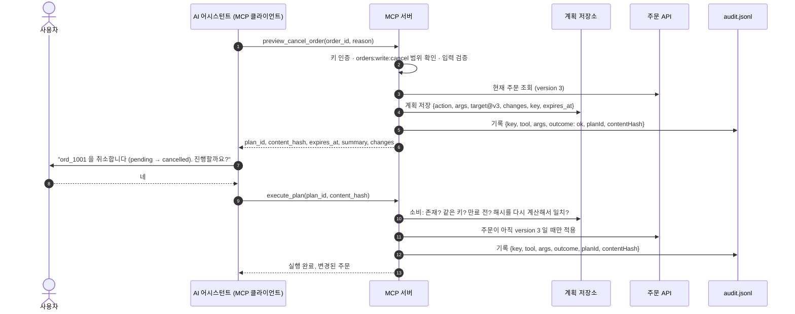

# mcp-safe-write-template (한국어)

AI 어시스턴트에게 **실제로 허락할 수 있는 쓰기 권한**을 주는 MCP 서버 템플릿입니다.

- **미리보기 → 확인 → 실행.** 모든 쓰기는 두 번의 호출입니다. 미리보기는 정확한 변경 내용(diff),
  `plan_id`, `content_hash`, 만료 시각을 돌려줍니다. `execute_plan` 을 그 id **와** 해시로 호출하기 전에는
  아무것도 바뀌지 않습니다. 실행은 한 번만, 미리보기를 만든 키로만, 만료 전에만, 그리고 그 사이 대상
  레코드가 바뀌지 않았을 때만 됩니다.
- **최소 권한 키.** 키마다 허용 범위(scope)를 명시적으로 나열합니다. 범위 밖 호출은 거부합니다.
  와일드카드가 없어서 도구를 새로 추가해도 기존 키의 권한이 몰래 넓어지지 않습니다.
- **감사 로그.** 호출마다 JSONL 한 줄 — 누가(키 id), 언제, 어떤 도구를, 어떤 인자로, 결과는 무엇이었는지.
  거부된 호출과 잘못된 입력도 남깁니다. 비밀값은 남기지 않습니다.
- **물리는지 확인된 테스트.** 안전 규칙마다 테스트가 있고, 변이 스크립트가 규칙을 하나씩 일부러 깨서
  테스트가 실제로 실패하는지 확인합니다.

예제 백엔드는 **가상의 주문 관리 API**(메모리)입니다. 실제 시스템에 붙일 때는 `src/domain/` 과
`src/tools.ts` 를 바꾸면 되고, 계획(plan)·권한·감사 로그 부분은 그대로 씁니다.

> 상태: 템플릿/참고 구현입니다. 단일 프로세스, stdio 전송만 지원합니다. 실제 시스템에 연결하기 전에
> 아래 [한계](#한계)를 읽어 주세요.

## 쓰기 흐름



`execute_plan` 이 거부하는 경우 (각 행마다 테스트가 있고, 그 규칙을 지우면 테스트가 실패하는 것을 변이로 확인했습니다):

| 상황 | 오류 코드 |
|---|---|
| 없는 plan id | `plan_not_found` |
| 같은 계획을 두 번 실행, 또는 실패한 시도 뒤에 다시 실행 | `plan_already_used` |
| `expires_at` 이후 호출 (기본 5분) | `plan_expired` |
| 미리보기를 만든 키가 아닌 다른 키로 호출 | `plan_key_mismatch` |
| `content_hash` 가 미리보기 내용과 다름 (또는 저장된 계획이 변조됨) | `hash_mismatch` (계획은 폐기) |
| 미리보기와 실행 사이에 주문이 바뀜 | `stale_plan` |
| 계획된 작업의 범위가 키에 없음 | `forbidden` |

해시는 작업·대상과 버전·인자·화면에 보여 준 변경 내용·키 id·만료 시각을 정렬된(canonical) JSON 으로
묶어 계산합니다. 실행 시에는 저장된 해시를 믿지 않고 저장된 계획에서 다시 계산합니다.

## 도구

| 도구 | 종류 | 필요한 범위 |
|---|---|---|
| `list_orders` | 조회 | `orders:read` |
| `get_order` | 조회 | `orders:read` |
| `preview_update_order_status` | 미리보기 (쓰지 않음) | `orders:write:status` |
| `preview_cancel_order` | 미리보기 (쓰지 않음) | `orders:write:cancel` |
| `preview_add_order_note` | 미리보기 (쓰지 않음) | `orders:write:note` |
| `execute_plan` | 쓰기 | 계획된 작업의 범위 |

도구 주석(annotations)에 미리보기는 읽기 전용, `execute_plan` 은 파괴적(destructive)이라고 표시해 두어서,
파괴적 호출 전에 사용자에게 묻는 클라이언트는 올바른 단계에서 묻습니다.

## 빠른 시작

Node.js 20 이상이 필요합니다.

```bash
npm install
```

```bash
npm run build
```

```bash
npm test
```

```bash
npm run demo
```

`npm install` 은 git 훅 경로도 `.githooks/` 로 설정합니다. `npm run demo` 는 빌드된 서버를 띄우고 실제 MCP
클라이언트로 조회 → 미리보기 → 실행 → 감사 로그 흐름을 돌려 출력합니다. 그 결과가
[`docs/demo.md`](../demo.md) 입니다.

### 키

`config/keys.example.json` 에는 비밀값이 공개된 **데모용** 키 세 개가 있습니다.

| 키 id | 비밀값 (데모 전용) | 범위 |
|---|---|---|
| `demo-reader` | `demo-reader-key-NOT-A-SECRET` | `orders:read` |
| `demo-support` | `demo-support-key-NOT-A-SECRET` | `orders:read`, `orders:write:note` |
| `demo-operator` | `demo-operator-key-NOT-A-SECRET` | 네 가지 전부 |

데모가 아니면 실제 키를 만드세요. 서버에는 비밀값의 sha256 만 저장됩니다.

```bash
npm run keygen -- --id support-bot --scopes orders:read,orders:write:note
```

출력된 항목을 `config/keys.json`(git 에서 제외됨)에 넣고, 출력된 비밀값은 클라이언트 설정에 넣습니다.

### 설정 (환경 변수)

| 변수 | 기본값 | 의미 |
|---|---|---|
| `MCP_API_KEY` | — (필수) | 이 서버 프로세스가 사용할 키의 비밀값. 유효하지 않으면 서버가 시작하지 않습니다. |
| `MCP_KEYS_FILE` | `config/keys.json` | 키 정의 파일 (id, sha256, scopes) |
| `MCP_AUDIT_FILE` | `audit/audit.jsonl` | 감사 로그 경로 (파일 권한 0600) |
| `MCP_PLAN_TTL_SECONDS` | `300` | 미리보기가 실행 가능한 시간 (10–3600초) |

## 클라이언트에 연결하기

먼저 `npm run build` 를 하고, 경로는 절대 경로로 적습니다.

### Claude Desktop

`claude_desktop_config.json`:

```json
{
  "mcpServers": {
    "orders": {
      "command": "node",
      "args": ["/absolute/path/to/mcp-safe-write-template/dist/index.js"],
      "env": {
        "MCP_KEYS_FILE": "/absolute/path/to/mcp-safe-write-template/config/keys.example.json",
        "MCP_API_KEY": "demo-operator-key-NOT-A-SECRET",
        "MCP_AUDIT_FILE": "/absolute/path/to/mcp-safe-write-template/audit/audit.jsonl"
      }
    }
  }
}
```

### Claude Code

```bash
claude mcp add orders \
  -e MCP_KEYS_FILE=/absolute/path/to/mcp-safe-write-template/config/keys.example.json \
  -e MCP_API_KEY=demo-reader-key-NOT-A-SECRET \
  -e MCP_AUDIT_FILE=/absolute/path/to/mcp-safe-write-template/audit/audit.jsonl \
  -- node /absolute/path/to/mcp-safe-write-template/dist/index.js
```

프로젝트 범위의 `.mcp.json` 을 레포에 두는 방법도 있습니다(Desktop 예시와 같은 `command`/`args`/`env` 모양).
실제 비밀값은 넣지 말고 `${MCP_API_KEY}` 처럼 셸 환경 변수를 참조하세요.

### MCP Inspector (CLI)

```bash
npx @modelcontextprotocol/inspector --cli -e MCP_KEYS_FILE=config/keys.example.json -e MCP_API_KEY=demo-reader-key-NOT-A-SECRET node dist/index.js --method tools/call --tool-name list_orders --tool-arg status=paid
```

## 유지보수 하네스

두 층으로 검사합니다.

**1. 기본층 — 어떤 편집기에서든, Claude Code 없이 동작**

- `.githooks/pre-commit`: 스테이징된 줄 시크릿 스캔, lint, typecheck, test
- `.githooks/commit-msg`: 커밋 메시지는 영어, 제목 72자 이하
- `.githooks/pre-push`: 전체 파일 시크릿 스캔, lint, typecheck, test
- CI (`.github/workflows/ci.yml`): Node 20·22 에서 같은 검사, 빌드된 서버로 데모 스모크 테스트, 변이 검사,
  레포 스캐너, gitleaks 전체 이력 스캔
- `scripts/secret-scan.mjs` 는 harness-engine 결정론 스캐너의 패턴 표를 옮겨 쓰고, 여기에 **금지어**(회사명,
  고객사명처럼 레포에 절대 들어가면 안 되는 이름) 검사를 더했습니다. 금지어 목록은 커밋하지 않습니다 —
  목록 자체가 유출이기 때문입니다. `DENY_TERMS` 환경 변수(CI 에서는 레포 시크릿)나 git 에서 제외된
  `.deny-terms` 파일로 넣습니다.

**2. Claude Code 층 — [harness-engine](https://github.com/SimSimEEE/harness-engine)**

harness-engine 은 Claude Code 용 커밋·PR 품질 게이트입니다. 결정론적 분류기가 검사 lane 을 고르고, 에이전트가
실행하고, `PreToolUse` 훅이 "지금 커밋할 내용 그대로"에 대한 통과 기록이 없으면 Claude 의 커밋·PR 생성을
막습니다.

harness-engine 은 원래 `~/.claude` 에 사용자 범위로 설치합니다. 이 레포는 대신 **프로젝트 범위의 오버레이**로
적용했습니다.

- `.claude/harness/ENGINE_PIN`: 엔진 버전과 커밋 고정
- `.claude/harness/setup.sh` (`npm run harness:setup`, Claude Code 클라우드 세션에서는 자동 실행): 고정된
  커밋을 받아 `.claude/` 아래 git 제외 폴더에 배치. `~/.claude` 는 건드리지 않음
- `.claude/settings.json`: 엔진 훅을 `.claude/harness/hook.sh` 를 거쳐 등록. 설치 전에는 아무것도 하지 않고,
  사용자 범위에 이미 등록돼 있으면 비켜섬
- `.claude/harness/categories/ts-mcp-server/`: 이 레포를 어떻게 테스트할지(vitest, 시크릿 스캔, 변이 검사)
  엔진에 알려 주는 카테고리. `.claude/harness/agents/test-runner.md` 는 엔진의 jest 단계를 vitest 로 바꾼 것
- `.claude/harness/profiles/`: 이 레포를 그 카테고리로 고정 (엔진의 `profile.sh` 로 생성)

맞춤 내용과 이유는 [`.claude/harness/README.md`](../../.claude/harness/README.md) 에 표로 정리했습니다.

## 한계

- **단일 프로세스, 메모리 계획 저장소.** 재시작하면 대기 중인 계획이 사라집니다(안전한 방향 — 다시
  미리보기). 여러 인스턴스로 돌리려면 `PlanStore` 를 원자적 소비(consume)가 되는 공유 저장소로 옮기세요.
- **stdio 전용, 프로세스당 키 하나.** `app.callTool` 이 호출마다 비밀값을 받도록 되어 있어서 요청별 키를
  쓰는 HTTP 전송은 연결 작업만 하면 되지만, 여기에는 포함·검증되어 있지 않습니다.
- **"확인"은 클라이언트의 몫입니다.** 서버는 실행되는 내용이 미리보기와 정확히 같다는 것을 보장하지만,
  사람이 "네"라고 했는지는 증명할 수 없습니다. 도구 호출을 보여 주고 파괴적 호출 전에 묻는 클라이언트를
  쓰고, 쓰기 범위가 있는 키는 그런 클라이언트에만 주세요.
- **비밀값 가리기는 필드 이름 기준입니다** (`password`, `token`, `apiKey` 등). 평범한 이름의 필드로 들어온
  비밀값은 기록될 수 있습니다. 입력 스키마가 모르는 필드를 거부하므로 범위는 좁습니다.
- 예제 도메인은 가상이고 저장소는 메모리입니다.

## 출처

- [harness-engine](https://github.com/SimSimEEE/harness-engine) (Apache-2.0): Claude Code 층, 그리고
  `scripts/secret-scan.mjs` 의 시크릿 패턴 표. [`NOTICE`](../../NOTICE) 참고
- [Model Context Protocol TypeScript SDK](https://github.com/modelcontextprotocol/typescript-sdk)

## 라이선스

[Apache License 2.0](../../LICENSE)
